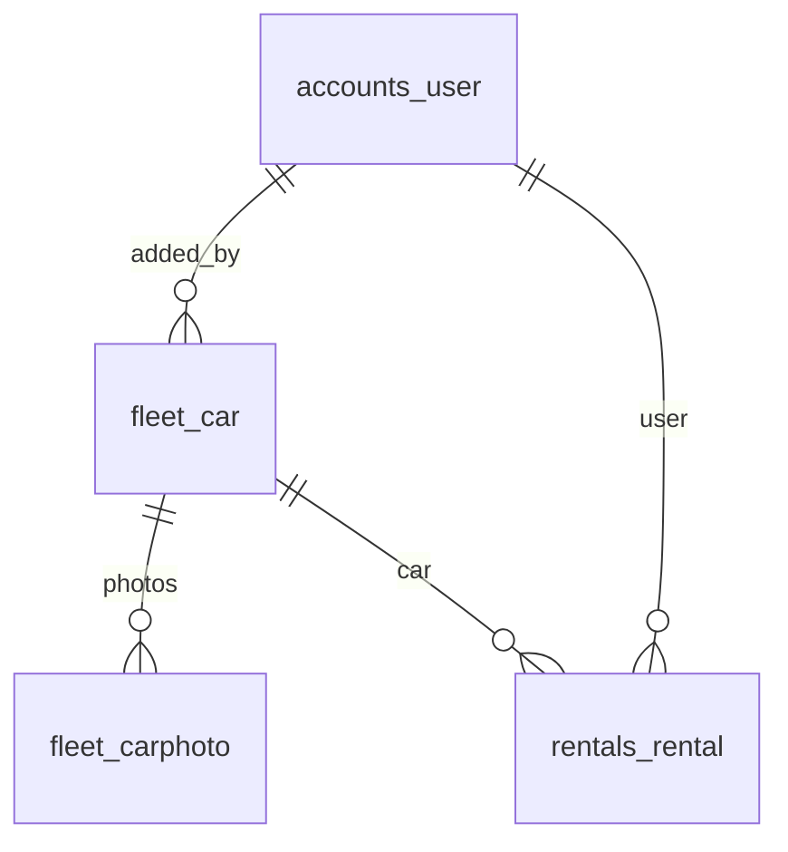
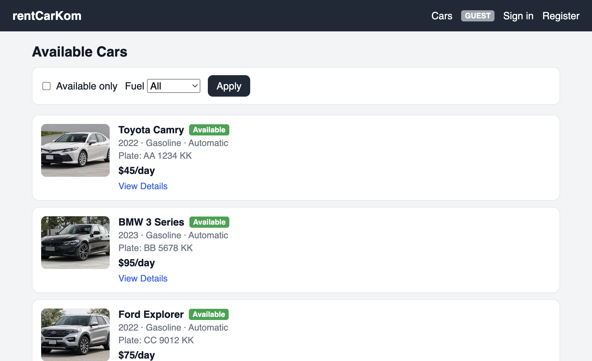
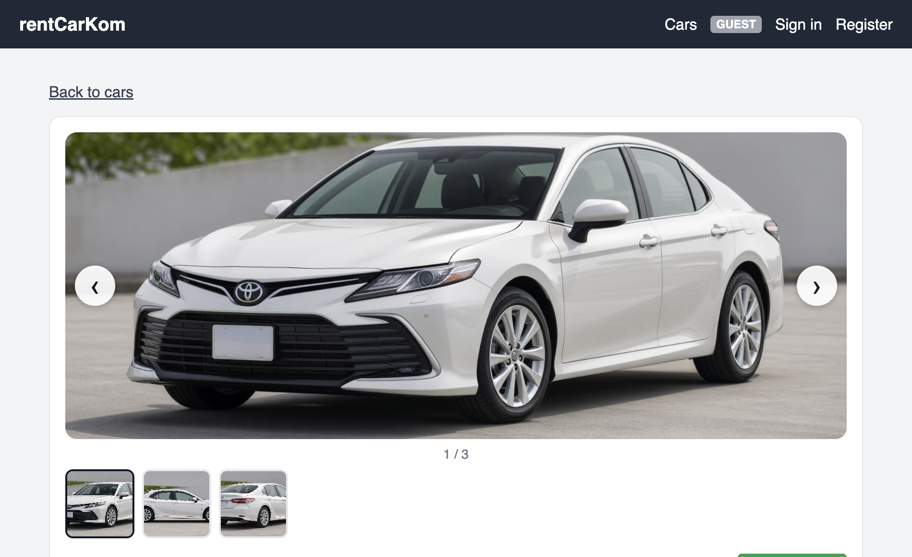
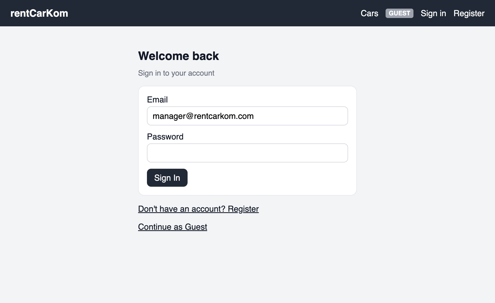
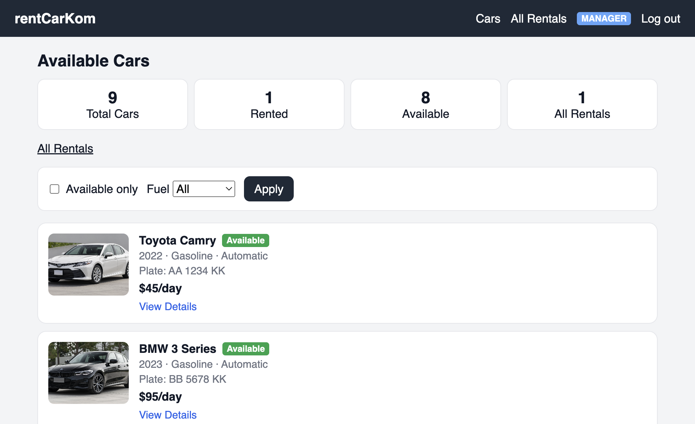
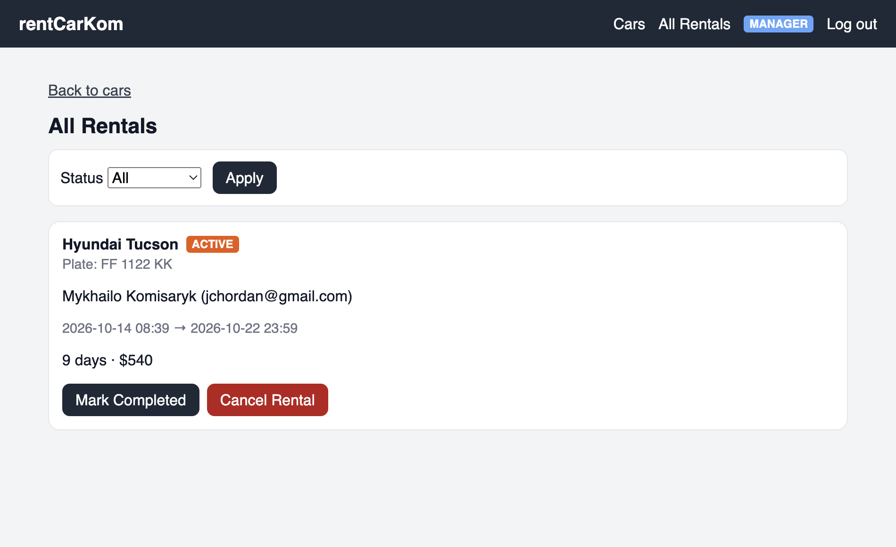

# Вступ

Оренда автомобіля потребує одночасного обліку вільного транспорту, клієнтів і статусу кожної броні. Якщо ці дані ведуться окремо, одне авто можуть забронювати двічі, а завершена оренда лишається в каталозі як активна.

У роботі розроблено вебсистему rentCarKom. Її тема: система автоматизації бронювання, обліку та супроводу оренди автомобілів. Система дає гостю переглянути автопарк, клієнту створити бронь, а менеджеру й адміністратору супроводити оренду до завершення або скасування.

Програму реалізовано на Django. Дані зберігаються в MySQL у схемі `rentcarkom`. Доступ до сторінок залежить від ролі користувача.

# Розділ 1. Розробка вебсайту та робота з базою даних

## 1.1. Аналіз предметної області та визначення функцій

### Опис предметної області

Предметна область — пункт прокату автомобілів. Компанія має парк машин. Кожна машина описана маркою, моделлю, роком, ціною за добу, кількістю місць, коробкою передач, типом палива, номерним знаком, кольором, пробігом і текстовим описом. До машини додають кілька фотографій.

Клієнт обирає вільне авто, вказує кількість діб і ім’я орендаря. Система фіксує початок і кінець оренди, ціну за добу на момент броні та загальну суму. Оренда має один зі статусів: активна, завершена або скасована. Поки оренда активна, це авто не пропонують іншому клієнту. Після завершення або скасування авто знову стає вільним.

Окремий прапорець «орендовано» в таблиці авто не зберігається. Вільність виводиться з наявності оренди зі статусом `active`. Так каталог не розходиться з журналом оренд.

### Цілі та завдання програми

Мета — скоротити ручний облік і не допустити подвійного бронювання одного автомобіля.

Завдання програми:

- показати каталог авто з фільтром за пальним і за вільністю;
- показати картку авто з фотографіями, характеристиками і ціною;
- зареєструвати клієнта і виконати вхід за електронною поштою;
- створити оренду лише для авторизованого користувача і лише якщо авто вільне;
- порахувати дату закінчення оренди і загальну суму;
- дати менеджеру і адміністратору статистику та журнал оренд;
- дати адміністратору додати авто, завантажити фото і видалити авто.

### Користувачі програми

У системі чотири режими доступу.

| Користувач | Як з’являється | Що може |
|---|---|---|
| Гість | Не входить у систему | Переглядає каталог і картку авто |
| Клієнт | Реєстрація, роль `client` | Те саме, що гість, і створює оренду |
| Менеджер | Обліковий запис із роллю `manager` | Те саме, що клієнт, плюс статистика і журнал оренд |
| Адміністратор | Обліковий запис із роллю `admin` | Те саме, що менеджер, плюс додавання, фото і видалення авто |

Гість не є рядком у таблиці користувачів. Це просто відвідувач без сесії.

### Функції програми

1. Перегляд каталогу за адресою `/`.
2. Фільтр «лише вільні» і фільтр палива: All, Gasoline, Diesel, Hybrid, Electric.
3. Картка авто `/cars/<id>/` з галереєю, стрілками і повноекранним переглядом.
4. Вхід `/accounts/login/`, реєстрація `/accounts/register/`, вихід.
5. Бронювання `/cars/<id>/rent/` з розрахунком суми `ціна × кількість діб`.
6. Статистика на головній для менеджера й адміністратора: усього авто, орендовані, вільні, усі оренди.
7. Журнал `/rentals/` зі статусами active, completed, cancelled.
8. Завершення і скасування активної оренди.
9. Додавання авто `/fleet/cars/new/`, завантаження фото і видалення авто. Ці дії доступні лише адміністратору.

### Обмеження та умови

- Оренда триває щонайменше одну добу.
- Ім’я орендаря обов’язкове.
- Другу активну оренду того самого авто система відхиляє.
- Новий користувач отримує роль клієнта. Роль менеджера або адміністратора через форму реєстрації не видається.
- Пароль облікового запису має щонайменше 6 символів і зберігається у вигляді хешу.
- Видалити авто, на яке вже є оренди, не можна: зв’язок із орендою захищений від видалення.
- Кінець оренди рахується через інтервал діб, а не додаванням числа до дня місяця, щоб бронь не ламалась на межі місяця.
- Дата кінця — 23:59:59 останньої включної доби в часовому поясі Europe/Kyiv.

## 1.2. Проєктування бази даних

### ERD

Логічна модель складається з чотирьох сутностей предметної області.

`accounts_user` зберігає людину, яка входить у систему. `fleet_car` — автомобіль. `fleet_carphoto` — файл фотографії цього авто. `rentals_rental` — одна бронь. Оренда зберігає і посилання на авто та користувача, і знімок марки, моделі, номера, пошти та ціни на момент створення. Якщо ціну авто пізніше змінять, уже створена оренда лишається зі старою сумою.

### Опис створених SQL-скриптів

Фізичну схему створює не ручний запуск скрипта, а міграції Django: `accounts/migrations/0001_initial.py`, `fleet/migrations/0001_initial.py`, `rentals/migrations/0001_initial.py`. Команда `python manage.py migrate` застосовує їх до MySQL, база `rentcarkom`.

Читабельний опис предметних таблиць зібрано у файлі `schema.sql`. Його не треба виконувати повторно на вже створеній базі. Скрипт задає такі об’єкти.

`accounts_user`. Первинний ключ `id`. Унікальний `email` є логіном. Поле `role` містить `client`, `manager` або `admin`. Поле `password` містить хеш, а не відкритий пароль.

`fleet_car`. Первинний ключ `id`. Унікальний `plate`. Ціна `price` — ціна за добу. Зовнішній ключ `added_by_id` посилається на користувача, який додав авто, і може бути порожнім.

`fleet_carphoto`. Первинний ключ `id`. Зовнішній ключ `car_id` посилається на авто. Поле `image` зберігає шлях до файлу в каталозі `media/cars/`.

`rentals_rental`. Первинний ключ `id`. Зовнішні ключі `car_id` і `user_id`. Поля знімка: `car_brand`, `car_model`, `car_plate`, `user_email`, `renter_name`, `price_per_day`, `total_price`. Статус — `active`, `completed` або `cancelled`.

Індекси прискорюють пошук авто за автором, фото за авто і оренд за авто та користувачем. Окреме обмеження задумане так, щоб в одного авто була лише одна активна оренда. У MySQL умовний унікальний індекс Django не створює, тому цю перевірку додатково виконує функція `create_rental` перед записом.

Окрім предметних таблиць, Django створює службові: групи, дозволи, сесії, журнал адмінки і список застосованих міграцій.

## 1.3. Опис програмної реалізації

### Призначення папок

| Папка або файл | Навіщо |
|---|---|
| `config` | Налаштування всього сайту: база, адреси, часовий пояс, підключення додатків |
| `accounts` | Користувачі, ролі, вхід, реєстрація, вихід |
| `fleet` | Автомобілі, фото, каталог, форма додавання і видалення |
| `rentals` | Бронювання, журнал оренд, завершення і скасування |
| `templates` | HTML-сторінки. Спільна шапка в `base.html`, сторінки розкладені по підпапках `accounts`, `fleet`, `rentals` |
| `static` | Файли оформлення: `css/app.css` і `js/gallery.js` |
| `media` | Завантажені фотографії авто. У git цей каталог не входить |
| `docs` | Текст цього розділу і знімки вікон |
| `manage.py` | Командний вхід Django: міграції, запуск сервера, початкові дані |
| `requirements.txt` | Список бібліотек Python |
| `schema.sql` | Текстовий опис предметних таблиць |
| `.env` | Локальні параметри підключення до MySQL. У git не входить |

Усередині `accounts`, `fleet` і `rentals` повторюється один і той самий каркас Django:

- `models.py` — таблиці;
- `views.py` — обробка сторінок;
- `urls.py` — адреси;
- `forms.py` — перевірка полів форм, де вона потрібна;
- `admin.py` — реєстрація моделей у вбудованій адмінці Django;
- `migrations` — історія змін структури бази;
- `tests.py` — перевірки прав і сценаріїв;
- `management/commands` — команди початкового наповнення `seed_users` і `seed_cars`.

`config/__init__.py` підключає драйвер PyMySQL. `config/settings.py` читає `.env` і вказує базу `rentcarkom` на `127.0.0.1:3306`. `config/urls.py` збирає адреси трьох додатків.

### Класи та функції Django

**Користувачі.** Клас `User` успадковує `AbstractUser`, але логіном є `email`, а не ім’я користувача. `UserManager.create_user` приводить пошту до нижнього регістру, вимагає ім’я і зберігає хеш пароля. Нова роль за замовчуванням — `client`. Властивості `is_admin_role` та `is_staff_role` відрізняють адміністратора від менеджера.

`RoleRequiredMixin`, `AdminRequiredMixin` і `StaffRoleRequiredMixin` закривають сторінки за роллю. Гість отримує перенаправлення на вхід. Користувач із чужою роллю отримує відмову.

`EmailLoginForm` перевіряє пару пошта-пароль. `RegisterForm` не пускає порожні поля, пароль коротший за 6 символів і вже зайняту пошту. `SignInView`, `RegisterView` і `SignOutView` показують відповідні сторінки. Після реєстрації роль лишається клієнтською.

**Автопарк.** `Car` і `CarPhoto` описують машину та її знімки. Властивість `Car.is_rented` і функція `annotate_availability` рахують активні оренди. `catalog_cars` застосовує фільтри палива і вільності.

`CarListView` показує каталог. `CarDetailView` показує картку, активну оренду для персоналу і власні оренди поточного користувача. `CarForm` перевіряє марку, модель, номер, рік у межах 1900–2100 і ціну більше нуля. `CarCreateView` зберігає авто і вибрані фото лише для адміністратора. `CarPhotoUploadView` додає фото до вже існуючого авто. `CarDeleteView` видаляє авто, а якщо на нього є оренди, показує відмову. Метод `Car.delete` після успішного видалення прибирає файли фото з диска.

**Оренда.** `Rental` зберігає бронь і знімок умов. `rental_end` ставить кінець на 23:59:59 останньої доби. `create_rental` у транзакції перевіряє тривалість, ім’я і відсутність активної оренди, потім записує суму. `complete_rental` переводить активну оренду в `completed` і ставить фактичний час завершення. `cancel_rental` ставить статус `cancelled`.

`RentCarView` приймає форму бронювання лише від увійшовшого користувача. `RentalListView` показує журнал менеджеру й адміністратору і фільтрує його за статусом. `RentalActionView` виконує завершення або скасування. `staff_stats` додає на головну чотири лічильники, якщо роль це дозволяє.

Галерея на картці авто працює у браузері: `static/js/gallery.js` змінює поточне фото стрілками, мініатюрами і клавішами, а клік по знімку відкриває його на весь екран.

## 1.4. Аналіз контрольного прикладу

Типовий сценарій проходить три ролі: гість дивиться авто, клієнт міг би його забронювати після входу, менеджер бачить наслідок уже створеної оренди і може її супроводити.

**Крок 1. Гість відкриває каталог.** За адресою `/` відвідувач без входу бачить бейдж GUEST, фільтри і список авто. У картці є фото, статус Available або Rented, рік, паливо, коробка, номер і ціна за добу.

Рисунок 1.1. Каталог автомобілів для гостя

**Крок 2. Гість відкриває картку.** На сторінці Toyota Camry показано велике фото, стрілки ліворуч і праворуч, лічильник `1 / 3` і три мініатюри. Клік по фото відкриває повноекранний перегляд. Замість форми броні гість бачить запрошення увійти.

Рисунок 1.2. Картка автомобіля з галереєю

**Крок 3. Вхід у систему.** Сторінка входу приймає email і пароль. Поруч є перехід до реєстрації і повернення в каталог як гість. Нова реєстрація створює клієнта. Для супроводу оренди в контрольному прикладі використано менеджера `manager@rentcarkom.com`.

Рисунок 1.3. Вікно входу

**Крок 4. Менеджер бачить облік.** Після входу бейдж змінюється на MANAGER. На головній з’являються лічильники. У контрольному стані бази вони такі: 9 авто, 1 орендоване, 8 вільних, 1 оренда в журналі. Орендованим позначено Hyundai Tucson, бо для нього існує запис зі статусом active.

Рисунок 1.4. Головна сторінка менеджера зі статистикою

**Крок 5. Супровід оренди.** Сторінка All Rentals показує Hyundai Tucson, номер FF 1122 KK, орендаря, інтервал з 14 до 22 жовтня 2026 року, 9 діб і суму 540. Менеджер може натиснути Mark Completed або Cancel Rental. Після завершення чи скасування авто знову стає вільним, і клієнт може створити нову бронь.

Рисунок 1.5. Журнал оренд і дії супроводу

Окремо адміністратор з роллю admin бачить кнопку Add Car, форму нового авто, завантаження фото і видалення. Ці елементи гостю і менеджеру не показуються.

Контрольний приклад підтверджує розділення функцій: гість лише читає каталог, бронь з’являється в журналі з розрахованою сумою, а менеджер бачить ту саму оренду і може змінити її статус.

# Висновок до 1 розділу

Предметну область прокату зведено до чотирьох сутностей: користувач, автомобіль, фотографія і оренда. Вільність авто не зберігається окремим прапорцем, а виводиться з активної оренди, тому каталог і журнал не розходяться.

Базу `rentcarkom` створюють міграції Django у MySQL. Скрипт `schema.sql` фіксує ті самі предметні таблиці, ключі та індекси в читабельному вигляді. Програмна частина розділена на `accounts`, `fleet` і `rentals`: ролі, автопарк і бронь не змішані в одному модулі.

Контрольний прохід показав каталог гостя, картку з галереєю, вхід, статистику менеджера і журнал активної оренди Hyundai Tucson на 9 діб сумою 540. Цього достатньо, щоб бронювати авто і супроводжувати оренду без подвійного зайняття однієї машини.
